<!-- Banner -->

  

  

---

## Connect with me. 😇

  
  
  
  

---

## About Me. 😊

- 🎓 3rd Year B.Tech CSE – **AI & Data Engineering** Student
- 🤖 Interested in **Artificial Intelligence & Machine Learning**
- 🐍 Exploring **Python** and **Data Engineering**
- ☁️ Learning **AWS** and **Microsoft Azure**
- 🚀 Building projects and solving real-world problems
- 💡 Always curious to learn new technologies
- 🤝 Looking to collaborate on AI/ML and web projects
- 📫 How to reach me: **maurya.aman.3952@gmail.com**

> ✨ *"It's all about creativity & problem solving."*

---

## 💻 Tech Stack

  
  
  
  
  
  
  
  
  
  
  
  
  
  
  

---

## 🚀 Featured Projects

| Project | Description |
|---|---|
| 📚 [Talk To Your Textbook](https://github.com/amanmaurya39/Talk-to-your-textbook) | RAG-based PDF question-answering application |
| 🧠 [MindSync-AI](https://github.com/amanmaurya39/MindSync-AI) | AI-based Tutor System |
| 🤖 [TRM-AI](https://github.com/amanmaurya39/TRM-AI) | AI based Transaction Risk Manager|
| 🍕 [PizzaPie](https://amanmaurya39.github.io/PizzaPie/) | Frontend web development project |
| 💻 [CPU Scheduler](https://amanmaurya39.github.io/Intelligent-CPU-Scheduler-Simulator/) | Intelligent CPU scheduling simulator |

---

<b>✨ Thanks for visiting my GitHub profile! ✨</b>

